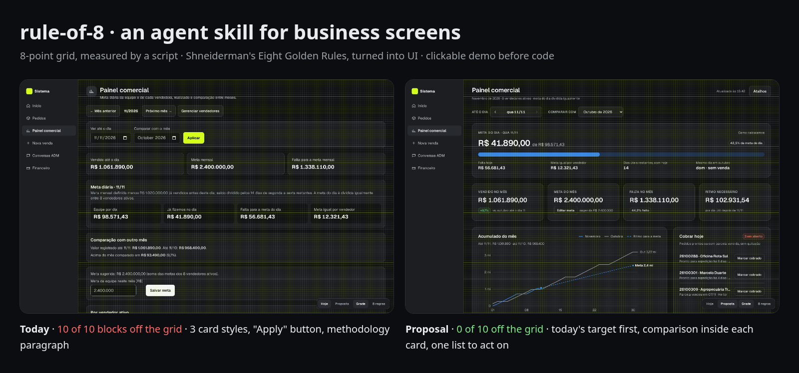

# rule-of-8

**An agent skill for the screens people work in all day:** dashboards, order lists, work queues, back-office forms and factory-floor tablets.

```bash
npx skills add zandobaldinho/rule-of-8
```

Works with Claude Code, Codex, Cursor and other agents that read `SKILL.md`. Or copy the folder to `~/.claude/skills/rule-of-8` (Claude Code) or `~/.agents/skills/rule-of-8` (Codex and others).



## What it makes your agent do

Most design skills make screens prettier. This one makes operations screens **measurable, reversible and honest**, and gets the owner's yes before any code changes.

1. **Reads the real screen first**: labels, columns, actions, permissions. The old screen is the checklist, so nothing disappears in the rewrite.
2. **Ships a clickable demo before the code**: one HTML file with a corner control, **Today / Proposal / Grid / 8 rules**, so the owner compares and decides on a phone.
3. **Puts everything on the 8 px grid and measures it** with a Playwright script: 3 widths × 2 themes, plus text contrast and 48 px touch targets. Exit code 1 if anything is off.
4. **Turns Shneiderman's Eight Golden Rules into UI**: one list with counted queues instead of five tabs, the right button on each row, Undo on every write, nothing reordering on its own, "comparison suspended" instead of a wrong number, 48 px targets for gloved hands.

Use it alongside a visual skill (frontend-design, shadcn, your design system). They pick the look; rule-of-8 settles how the screen works.

## Proof, not vibes

```
$ node measure-grid.mjs "demo.html?mode=today#painel" "demo.html#painel"
demo.html?mode=today#painel · 1440 dark: 0/10 on the grid
demo.html#painel · 1440 dark: 10/10 on the grid
…
```

**A/B test.** Two agents (same model) redesigned the same messy orders screen, one with the skill and one without. A third agent, not told which was which, clicked through both in a real browser and scored them on 10 criteria:

| | Without the skill | With the skill |
|---|---|---|
| Blind review score | **54 / 100** | **78 / 100** |
| Top-level blocks on the 8 px grid (1440 / 1024 / 390) | 0/19 · 0/19 · 1/19 | 6/6 · 6/6 · 6/6 |
| Undo 8 seconds after an action | gone with the toast | still on the row |
| Cancel / delete | one tap, no confirmation | disabled until you type the order number |
| After resolving a row | row disappears from the queue | row stays in place, marked done, with "Next pending" |
| Average ticket with one order missing its amount | card removed | card kept, marked "suspended: #1049 has no amount" |

One run, one screen. It's a smoke test, not a benchmark, and the skill's version had defects too (they became new rules in `references/`).

**Trigger test:** 20 requests, 10 that should load the skill and 10 near-misses (landing page, portfolio, unit tests). 20/20 correct, with more than 100 other skills installed. Details and the test screen are in [`evals/`](evals/).

## Try it

Ask your agent:

- *"Redesign this dashboard with the rule of 8."*
- *"Make a demo of the orders screen before we code it."*
- *"This list has too many tabs and the alert box takes over the page. Fix it."*

To see the result before installing anything, open [`assets/example-demo.html`](assets/example-demo.html) (a full demo from the original project, UI in Brazilian Portuguese) or [`assets/demo-skeleton.html`](assets/demo-skeleton.html) (the English starting point).

## What's inside

| File | What it's for |
|---|---|
| `SKILL.md` | The 7-step method and the principles that hold for any screen |
| `references/grid.md` | The size scale and the traps that knock a screen off the grid |
| `references/golden-rules.md` | The eight rules, the pattern that works for each and the mistake each one prevents |
| `references/dashboard-model.md` | One dashboard layout for every area, which chart for which question, and numbers people can trust |
| `references/demo.md` | How to build the demo, the presenter control and how to read feedback |
| `references/shipping.md` | From demo to production: deploys, data, permissions and working with agents |
| `scripts/measure-grid.mjs` | Playwright check at 3 widths × 2 themes: blocks on the grid, text contrast, 48 px touch targets, no sideways scroll, no JS errors |
| `assets/demo-skeleton.html` | English demo starter: presenter control, grid overlay, rules panel, Undo toast |
| `assets/example-demo.html` | A full example demo (Orders + Sales dashboard, fake data; UI in Brazilian Portuguese) |
| `evals/` | The trigger queries, the messy test screen and the A/B results |

The grid check needs Playwright in the project you run it from: `npm i -D playwright && npx playwright install chromium`.

## Where it came from

It grew out of redesigning a real order, production and sales system for a factory in Brazil, with the owner signing off on every version. Each rule in `references/` is there because something shipped wrong without it: an alert block that "takes over the screen for nothing", a dashboard that counted holidays as workdays, a rewrite that silently dropped a filter.

## Further reading

- Ben Shneiderman, *The Eight Golden Rules of Interface Design*: https://www.cs.umd.edu/users/ben/goldenrules.html
- *Designing the User Interface*, 6th ed. (Pearson, 2016), section 3.3.4.
- Intro with examples (IxDF): https://ixdf.org/literature/article/shneiderman-s-eight-golden-rules-will-help-you-design-better-interfaces

## License

MIT.
